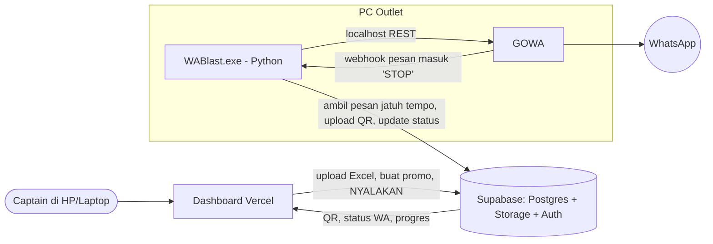
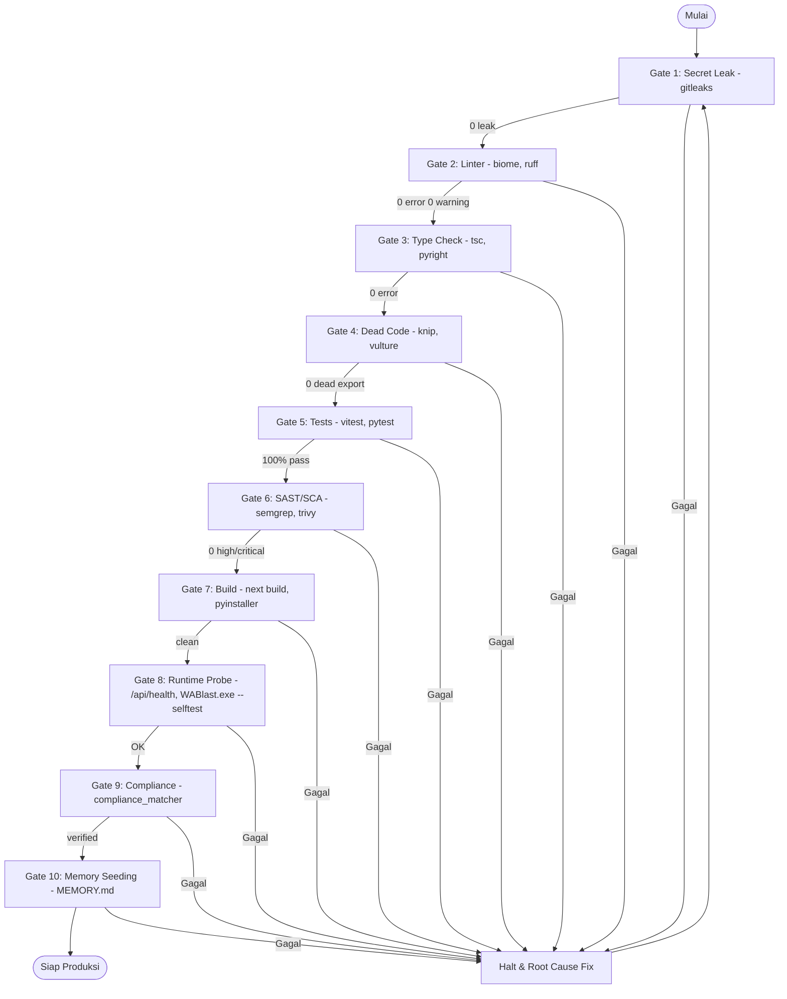

<!-- AGENTS_ORCHESTRATOR_METADATA: {
  "engine": "plan_architect.py",
  "version": "4.0.0",
  "mode": "greenfield",
  "domain": "web_service_microservices",
  "subsystems_executed": [
    "repo_auditor.audit_all",
    "requirements_decomposer.decompose",
    "audit_gap_extractor.extract",
    "compliance_matcher.match_compliance",
    "stack_detector.resolve_greenfield_stack",
    "dynamic_quality_gates.resolve_gates",
    "database_schema_designer.generate_schema_blueprint",
    "devsecops_pipeline_generator.generate_pipeline_spec",
    "graph_bridge.grounding",
    "enterprise_plan_architect.assemble_gold_standard"
  ],
  "prompt_fingerprint": "-2455353429283901220",
  "provenance_verified": true,
  "persistence_override": "relational"
} -->

# Implementation Plan: WA Blast Promo untuk 6 Outlet

Aplikasi kirim promo (1 foto + tulisan) lewat WhatsApp nomor biasa milik captain tiap outlet, ke daftar kontak hasil import Excel. Pilot: 1 outlet dulu, 5 outlet lain ikut pola yang sama.

Susunan (diputuskan 2026-10-27, gratis, tanpa VPS):
- **Dashboard web di Vercel**: semua pengaturan (QR, kontak, promo, tombol NYALAKAN, progres). Captain buka 1 link dari HP/laptop.
- **`WABlast.exe` di PC tiap outlet**: mesin kirim tanpa layar (Python + GOWA). Diinstal sekali, otomatis menyala saat PC hidup.
- **Supabase**: data dan penghubung. Dashboard dan exe tidak saling memanggil; keduanya hanya membaca/menulis tabel Supabase. Update dashboard tidak perlu install ulang exe.

Skeleton dihasilkan oleh `python .agents/scripts/plan_architect.py --mode greenfield` (stack terdeteksi: `typescript-node-nextjs16`). Skema contoh generator (`player_states`) dibuang dan diganti skema domain di bawah.

---

## User Review Required

> [!IMPORTANT]
> **1. Risiko blokir tidak bisa nol.** Nomor WA biasa + gateway tidak resmi (GOWA) melanggar Ketentuan Layanan WhatsApp. Yang bisa dilakukan hanya **menurunkan risiko**:
> - Kirim hanya ke pelanggan yang memang pernah memberi nomor ke outlet (opt-in).
> - Jeda acak antar pesan, batas harian per nomor, jam kirim saja. Semua angka disimpan di tabel `outlets`, bisa diubah dari dashboard.
> - Nomor baru dipanaskan dulu (batas harian kecil, naik bertahap).
> - Balasan "STOP" otomatis mengeluarkan kontak dari daftar.
> - Risiko blokir nol hanya lewat **WhatsApp Cloud API resmi** (berbayar, template disetujui Meta).

> [!IMPORTANT]
> **2. The 4 Zeros, sesuai ukuran proyek:**
> - **Zero Mock Data**: tes kirim memakai nomor HP tim asli.
> - **Zero Hardcode**: URL/kunci lewat env (`zod` di web, `pydantic-settings` di exe); jeda, batas harian, jam kirim lewat kolom tabel `outlets`.
> - **Zero Fallback**: gagal kirim dicatat di `messages.error` dengan status `failed`, tidak ditelan.
> - **Zero Timeout**: tidak ada `sleep()` antar pesan. Jadwal kirim berikutnya disimpan di DB (`outlets.next_send_at`). Exe hanya mengambil pesan yang sudah jatuh tempo memakai `FOR UPDATE SKIP LOCKED`; PC mati lalu hidup lagi, antrean lanjut dari posisi terakhir tanpa pesan ganda.

> [!WARNING]
> **3. Keamanan & OCC:**
> - Exe **tidak** menyimpan service-role key. Exe login sebagai akun outlet (Supabase Auth), jadi RLS membatasi exe hanya ke data outlet itu. Kalau PC dibongkar, outlet lain aman.
> - `outlets` dan `campaigns` punya kolom `version`. Update pakai `WHERE id = $1 AND version = $2`; 0 baris = `409 Conflict`.

> [!NOTE]
> **4. Penyederhanaan yang disengaja:** Supabase Auth + RLS menggantikan Better Auth + OpenFGA (cukup untuk 6 akun). Antrean Postgres menggantikan Temporal/Kafka. Tambahkan jika volume naik jauh.
>
> **5. Vercel Hobby (gratis)** menurut ketentuan Vercel untuk pemakaian non-komersial. Alternatif gratis dengan kode sama: Netlify / Cloudflare Pages. Keputusan hosting final di Phase 3.

---

## Open Questions

Tidak memblokir Phase 1, perlu jawaban sebelum Phase 5 (pilot):
1. **Kontak opt-in?** Apakah semua nomor di Excel pelanggan yang pernah memberi nomor ke outlet?
2. **Format Excel**: kolom apa saja? Default asumsi: `nama`, `nomor`. Kirim 1 contoh (boleh disensor).
3. **Supabase**: buat 1 project, isi `.env.local` sendiri (jangan kirim kunci lewat chat).

---

## Proposed Changes

### Pilihan Engine WA (hasil riset GitHub)

| Opsi | Lisensi | Banyak nomor gratis | Kirim gambar | Catatan |
| :--- | :--- | :--- | :--- | :--- |
| **go-whatsapp-web-multidevice (GOWA)** ✅ dipilih | MIT | Ya (sejak v8, `X-Device-Id`) | `POST /send/image` | Ditulis dengan Go, bisa jalan sebagai program biasa tanpa Docker (binary Windows dicek di Phase 1) |
| WAHA | Apache-2.0 | Multi-session di versi Plus (berbayar) | Ya | Dashboard bagus, multi-nomor gratis belum pasti |
| Evolution API | Apache-2.0 + syarat brand | Ya | Ya | Sejak v2.4.0 wajib aktivasi ke server lisensi mereka |
| Baileys (library) | MIT | Ya | Ya | Terlalu low-level |
| WhatsApp Cloud API (resmi) | - | Ya | Ya (template) | Tanpa risiko blokir, berbayar |

Ganti nomor sender = tombol "Ganti Nomor" di dashboard → exe logout GOWA → QR baru muncul → scan HP baru. Kontak dan promo tetap.

### Alur Sistem

### 1. Skema Database (Supabase Postgres)

Primary key `uuidv7()` jika Postgres project sudah versi 18; jika belum, `gen_random_uuid()` (dicek di Phase 1).

- **`outlets`**: `id`, `name`, `owner_user_id → auth.users`, `wa_status` (`disconnected|waiting_qr|connected`), `qr_image_path`, `wa_number`, `daily_limit int`, `delay_min_sec int`, `delay_max_sec int`, `send_start time`, `send_end time`, `next_send_at timestamptz`, `last_seen_at timestamptz` (detak exe, untuk tampilan "PC menyala ✅ / mati ❌"), `version int default 1`, `created_at`, `updated_at`.
- **`contacts`**: `id`, `outlet_id`, `phone text` (format `628…`), `name`, `opted_out bool default false`, `created_at`, `UNIQUE(outlet_id, phone)`.
- **`campaigns`**: `id`, `outlet_id`, `title`, `message text`, `image_path text`, `status` (`draft|running|paused|done`), `version int default 1`, `created_at`, `updated_at`.
- **`messages`** (antrean): `id`, `campaign_id`, `contact_id`, `status` (`queued|sending|sent|failed|skipped`), `attempts int`, `error text`, `sent_at`, `UNIQUE(campaign_id, contact_id)`.
- **`commands`**: `id`, `outlet_id`, `type` (`relogin`), `done_at` — perintah dari dashboard ke exe (mis. "Ganti Nomor").
- **Fungsi `claim_next_message(outlet_id)`** (`SECURITY DEFINER`, cek `auth.uid()` pemilik outlet): cek jam kirim, batas harian, `next_send_at <= now()`; ambil 1 pesan `queued` dengan `FOR UPDATE SKIP LOCKED`; set `next_send_at = now() + jeda acak`. Satu transaksi.
- **RLS** di semua tabel: hanya baris outlet milik `auth.uid()`.
- **Storage bucket** private `campaign-images` dan `qr-codes`.

### 2. Berkas — Mesin Kirim (`agent/`, Python) — sudah dibangun

#### [NEW] `agent/pyproject.toml`
Python 3.13+ (uv, `exclude-newer` 2 minggu), `supabase`, `httpx`, `pydantic-settings`; dev: `pytest`, `ruff`, `pyright`, `mypy`, `vulture`, `pyinstaller`.

#### [NEW] `agent/wablast/config.py`
`pydantic-settings`: `SUPABASE_URL`, `SUPABASE_ANON_KEY`, `GOWA_PORT`, `WEBHOOK_PORT`, `TICK_SECONDS`, `SIGNED_URL_SECONDS`, `STOP_KEYWORDS`. Exe hanya membaca `wablast.env` di sebelahnya.

#### [NEW] `agent/wablast/session.py`
Login pertama kali (jendela kecil tkinter: email + kata sandi outlet), sesi disimpan di `%APPDATA%\WABlast\session.json`.

#### [NEW] `agent/wablast/gowa.py`
Jalankan GOWA v9.6.0 (localhost, kredensial acak tiap start, UI & MCP mati); wrapper REST: status, QR, logout, kirim teks/gambar.

#### [NEW] `agent/wablast/worker.py`
Tick: `commands` → status WA (QR ke storage `qr-codes` / `connected`) → detak `last_seen_at` → `claim_next_message` → signed URL gambar → kirim → `complete_message`. Startup: `fail_stuck_messages`.

#### [NEW] `agent/wablast/webhook.py`
Webhook lokal GOWA (HMAC `X-Hub-Signature-256`): balasan "STOP/BERHENTI" → `opt_out_contact`.

#### [NEW] `agent/wablast/main.py`, `agent/launcher.py`, `agent/build.bat`
`build.bat` → `dist/WABlast.exe` (GOWA di dalamnya, tanpa jendela konsol) + `dist/wablast.env`. Autostart Windows dipasang sekali saat instalasi: `WABlast.exe --autostart` (hapus: `--no-autostart`).

### 3. Berkas — Dashboard (`web/`, Vite + React, file statis) — sudah dibangun

Diganti dari Next.js ke Vite: dashboard tidak butuh server sendiri (semua lewat Supabase + RLS), jadi hasil build berupa file statis yang bisa di-host gratis di Vercel / Netlify / Cloudflare Pages.

#### [NEW] `supabase/migrations/20261027000000_init.sql`
Tabel, index, RLS, trigger versi, view `campaign_progress`, fungsi `set_campaign_status` / `claim_next_message` / `complete_message` / `fail_stuck_messages` / `opt_out_contact`, bucket. Konflik versi → SQLSTATE `PT409` → **HTTP 409**.

#### [NEW] `web/src/supabase.ts`, `web/src/contacts.ts` (+ test)
Client Supabase (gagal cepat jika env kosong); normalisasi nomor & baca kolom Excel.

#### [NEW] Halaman (bahasa sederhana): `App.tsx`, `PromoTab.tsx`, `ContactsTab.tsx`, `ConnectTab.tsx`, `SettingsTab.tsx`
1. **Masuk**: email + kata sandi.
2. **Promo**: buat promo (foto + pesan + `{nama}`), tombol besar **NYALAKAN / MATIKAN**, progres, daftar gagal.
3. **Kontak**: upload Excel/CSV, ringkasan nomor masuk/salah/dobel, cari, hapus.
4. **WhatsApp**: status PC, QR + langkah scan, tombol "Ganti nomor".
5. **Pengaturan**: batas harian, jeda, jam kirim (OCC).

### 4. Pengaman Risiko Blokir — sudah dibangun

#### [NEW] `supabase/migrations/20261027010000_risk_controls.sql`
Pengaturan per outlet (default aman, bisa diubah dari dashboard atau Supabase): `warmup_enabled` / `warmup_start_limit` / `warmup_daily_increase`, `check_number_first`, `pause_after_failures`, `min_days_between_promos`, `optout_footer`, `stop_keywords`. Fungsi baru: `effective_daily_limit`, `today_limit`, `mark_number_linked`, `auto_pause`, `finish_message` (menggantikan `complete_message`). Kontak `not_on_whatsapp` tidak pernah dikirimi lagi.

#### [MODIFY] `agent/wablast/worker.py`, `gowa.py`, `webhook.py`, `main.py`, `config.py`
Agent membaca ulang baris outlet tiap tick; cek nomor via GOWA `/user/check`; kalimat penutup; berhenti otomatis saat WA terputus; kata STOP dari database (`STOP_KEYWORDS` env dihapus).

#### [MODIFY] `web/src/SettingsTab.tsx`, `PromoTab.tsx`, `ContactsTab.tsx`, `App.tsx`, [NEW] `web/src/caption.ts`
Bagian "Pengaman nomor", contoh pesan final, peringatan kuning saat berhenti otomatis, penanda kontak tanpa WhatsApp, batas pesan hari ini.

Panduan: `docs/guides/panduan-captain.md`, `docs/guides/pengaturan-backend.md`.

#### [NEW] `.env.example`, `.gitleaks.toml`
`VITE_SUPABASE_URL`, `VITE_SUPABASE_ANON_KEY` + variabel agent. Gitleaks mengecualikan path yang sama dengan `.gitignore`.

---

## While-Loop Sequential Execution Architecture

Gate dijalankan berurutan 1 sampai 10. Gate N gagal: berhenti, perbaiki akar masalah, ulang dari Gate 1. Maksimal 5 siklus perbaikan berturut-turut, lalu laporan diagnostik ke pengguna (Human-in-the-Loop).

### Failure Handling State Machine
1. **Halt & Root Cause Analysis**: tidak boleh lanjut ke Gate N+1 atau membungkam error.
2. **Regression-Free Verification**: setelah perbaikan, ulang dari Gate 1.
3. **Batas 5 siklus**, lalu eskalasi ke pengguna.

---

## Ringkasan Kepatuhan

| Standar | Kontrol yang diterapkan |
| :--- | :--- |
| **UU PDP No. 27/2022** | Hanya kontak opt-in; "STOP" dihormati; nomor tidak ditulis ke log; tombol hapus kontak. |
| **ISO/IEC 27001:2022 A.8.24** | Exe tanpa service-role key; RLS per outlet; webhook GOWA hanya di localhost. |
| **SOC-2 CC7.2** | Tabel `messages` mencatat status, waktu, dan error setiap kirim. |
| **WhatsApp ToS** | Risiko blokir diterima pemilik (User Review Required no. 1). |

---

## Verification Plan

### Automated Tests (Dynamic Quality Gates 1..10)
1. `gitleaks detect --no-git --verbose`
2. `npx biome check .` (web) dan `uv run ruff check .` (agent)
3. `npm run typecheck` (web) dan `uv run mypy` + `uv run pyright` (agent)
4. `npx knip` (web) dan `uv run vulture wablast tests --min-confidence 80` (agent)
5. `npx vitest run` (web) dan `uv run pytest` (agent, butuh `npx supabase start`)
6. `semgrep scan --config p/security-audit` (web + agent); `trivy` belum terpasang
7. `npm run build` (web) dan `agent\build.bat` (exe)
8. Runtime probe Node + Python; exe hasil build dijalankan ke Supabase lokal dan menerbitkan QR

> Catatan (2026-10-27): bug runner di Windows sudah diperbaiki di `.agents/` (pemecahan `(cd A && x) && (cd B && y)`, probe `python`, vulture tanpa `.venv`). `while_loop_runner.py --run --report` lolos 10/10.
9. `python .agents/scripts/compliance_matcher.py`
10. `python .agents/scripts/while_loop_runner.py --verify-hermes`

Seluruh rangkaian: `python .agents/scripts/while_loop_runner.py --run --report`

### Manual / Runtime Verification
1. **Kirim 1 pesan manual** via `curl` ke GOWA → foto + teks masuk HP tim.
2. **QR dari dashboard**: QR muncul di web, discan, status jadi "tersambung".
3. **Kampanye kecil** ke 3 nomor tim: jeda sesuai `delay_min_sec..delay_max_sec`.
4. **Restart PC** saat kampanye jalan → exe nyala sendiri, tidak perlu scan ulang, antrean lanjut tanpa pesan ganda.
5. **STOP test**: balas "STOP" → kontak `opted_out`, sisa pesan `skipped`.
6. **RLS test**: akun outlet A tidak bisa membaca data outlet B.
7. **Ganti nomor** dari dashboard → QR baru → scan nomor lain → kirim berhasil.
