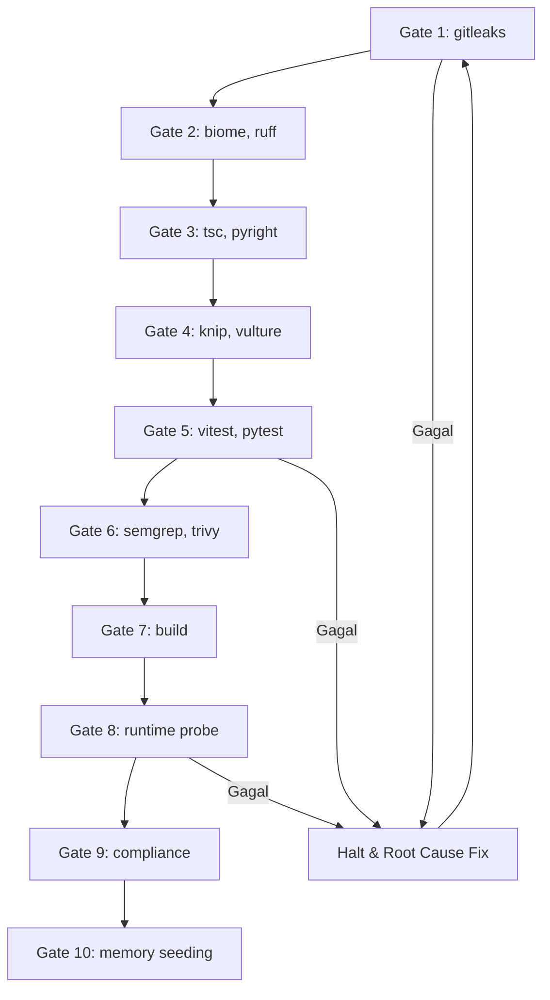

<!-- AGENTS_ORCHESTRATOR_METADATA: {
  "engine": "plan_architect.py",
  "version": "4.0.0",
  "mode": "feature",
  "domain": "web_service_microservices",
  "persistence_override": "relational"
} -->

# Implementation Plan: Grup Terpisah Dowa dan Sanghyang di WA Blast
> Status 2026-11-04: **ditunda** atas permintaan pengguna. Kontak Sanghyang diimpor ke akun outlet `dowa` yang sudah ada.

WA Blast dipakai dua bisnis: outlet Dowa (Sunset Grill, D'Spa, D'Bistro, DBC, Rooms, D'Bar, dowa) dan Sanghyang (Sanghyang Indah Spa Resort, BC Padel Club). Data tetap di satu project Supabase (WABLAST, ref `wnnxiprxasbiptpvwsmz`), tetapi setiap bisnis hanya melihat dan mengatur outletnya sendiri, dengan alamat web, username, dan password sendiri.

Keputusan pengguna (2026-11-04): satu kode, grup terpisah. Akun awal Sanghyang: 1 supervisor. Supervisor itu membuat akun outlet Sanghyang sendiri lewat menu Admin.

---

## User Review Required

> [!IMPORTANT]
> **1. Supervisor Dowa saat ini bisa melihat semua outlet.** Setelah perubahan ini, supervisor hanya melihat outlet di grupnya. Semua akun lama masuk grup `dowa`, jadi untuk Dowa tidak ada yang berubah.
>
> **2. Langkah produksi dikerjakan pemilik** (token Management API sudah dicabut 2026-11-03): tempel 1 file SQL di SQL Editor, tempel kode fungsi `admin` di Edge Functions, dan buat 1 project Vercel baru.
>
> **3. Opt-out tetap berlaku lintas grup.** DATABASE NOMOR membaca opt-out dari semua outlet. Nomor yang pernah membalas STOP ke outlet Dowa juga tidak diimpor ke Sanghyang (lebih aman untuk risiko blokir).
>
> **4. The 4 Zeros.**
> - **Zero Mock Data**: test RLS memakai Supabase lokal sungguhan dan akun yang dibuat lewat Auth, bukan stub.
> - **Zero Hardcode**: grup dashboard dari `VITE_GROUP`; grup akun dibaca dari database, bukan dari kode.
> - **Zero Fallback**: fungsi database menolak akses lintas grup dengan error 42501, fungsi `admin` dengan 403. Baca tabel lewat RLS hanya mengembalikan baris grup sendiri (perilaku standar RLS).
> - **Zero Timeout**: tidak ada jeda atau retry baru; perubahan hanya di aturan akses.

## Open Questions
Tidak ada. Nama grup: `dowa` dan `sanghyang`. Username supervisor Sanghyang: `sanghyang`.

---

## Proposed Changes

Semua hak akses di database sudah lewat satu fungsi `owns_outlet()` (RLS tabel, storage, `claim_next_message`, `outlet_overview`, dll.). Jadi cukup fungsi itu yang diubah, ditambah fungsi `admin` yang memakai service-role key.

### 1. Database
#### [NEW] `supabase/migrations/20261104000000_outlet_groups.sql`
- Kolom `group_name text not null default 'dowa'` di `outlets` dan `supervisors`, dengan cek format `^[a-z0-9-]{2,30}$`.
- `owns_outlet()`: pemilik outlet, atau supervisor yang `group_name`-nya sama dengan outlet.
- `allow_contact_again()`: selain `is_supervisor()`, wajib `owns_outlet()` atas kontak itu.

### 2. Fungsi `admin` (Edge Function)
#### [MODIFY] `supabase/functions/admin/index.ts`
- Grup pemanggil dibaca dari `supervisors.group_name`.
- `list`: hanya outlet dan supervisor dari grup pemanggil.
- `create_outlet` dan `create_supervisor`: akun baru masuk grup pemanggil.
- `set_password`: ditolak (403) kalau akun target bukan outlet atau supervisor di grup pemanggil. Sekarang supervisor bisa mengganti password akun mana pun.

### 3. Dashboard
#### [MODIFY] `web/src/login.ts`, `web/src/login.test.ts`, `web/src/App.tsx`, `web/index.html`, `.env.example`
- Variabel build `VITE_GROUP` (default `dowa`). Daftar outlet di halaman login dipilih per grup; grup `sanghyang` mulai kosong (login lewat "Lainnya").
- Judul halaman dan login menampilkan nama grup ("WA Blast Sanghyang").
- Deploy: project Vercel baru `wa-blast-sanghyang` dari folder `web/` yang sama, env `VITE_GROUP=sanghyang`.

### 4. WABlast.exe
Tidak berubah. Exe sudah memilih outlet berdasarkan pemilik akun, jadi exe yang sama dipakai kedua grup.

---

## While-Loop Sequential Execution Architecture
Gate 1 sampai 10 berurutan (sama dengan `implementation_plan.md`). Gate gagal: berhenti, perbaiki akar masalah, ulang dari Gate 1. Maksimal 5 siklus, lalu laporan ke pengguna.

## Ringkasan Kepatuhan
| Standar | Kontrol |
| :--- | :--- |
| **ISO/IEC 27001:2022 A.8.3** | Akses data dibatasi per grup lewat RLS `owns_outlet()`; ganti password dibatasi per grup. |
| **ISO/IEC 27001:2022 A.8.24** | Service-role key tetap hanya di Edge Function. |

---

## Verification Plan

### Automated Tests
1. Test SQL ke Supabase lokal (`npx supabase start`): supervisor `sanghyang` tidak bisa membaca outlet, kontak, promo, atau file outlet Dowa; supervisor Dowa tidak bisa membaca outlet Sanghyang; captain tetap hanya outletnya sendiri.
2. `web/src/login.test.ts`: daftar login per grup.
3. Gate 1..10 lewat `python .agents/scripts/while_loop_runner.py --run --report`.

### Manual / Runtime Verification
1. Pemilik menjalankan migrasi di SQL Editor, lalu login sebagai supervisor Dowa: semua outlet Dowa masih terlihat.
2. Supervisor Dowa membuat supervisor `sanghyang` di menu Admin; pemilik memindahkannya ke grup `sanghyang` dengan 1 baris SQL.
3. Login `sanghyang` di alamat web baru: tidak ada outlet Dowa; buat outlet Sanghyang Indah Spa Resort dan BC Padel Club; login Dowa tidak melihat keduanya.
